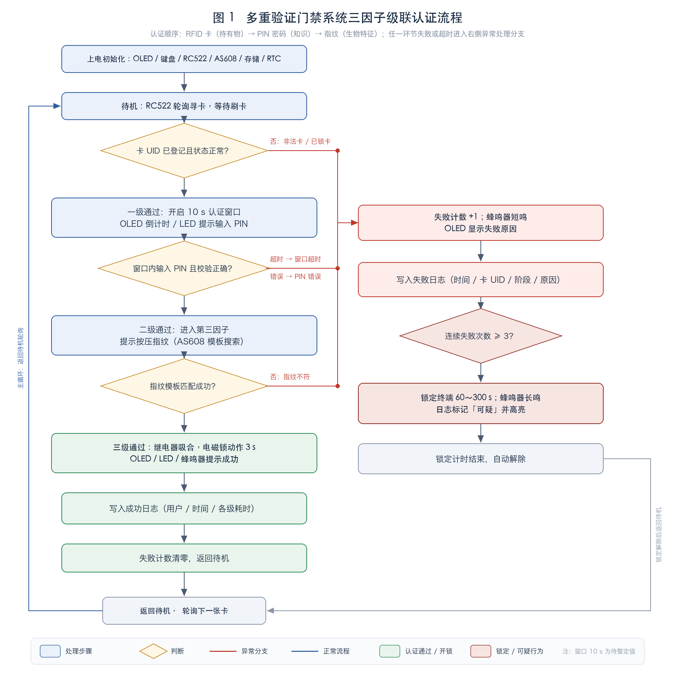
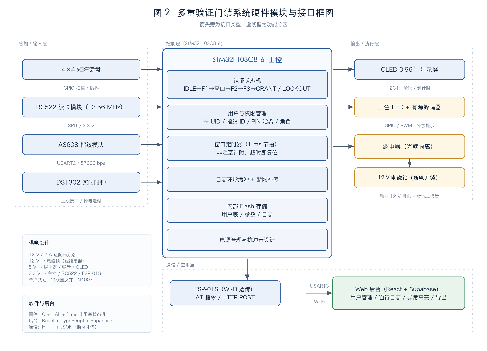

# 多重验证门禁系统（毕业设计）

**武汉纺织大学 · 电子与电气工程学院 · 通信工程 2027 届**
课题：**多重验证门禁系统研究与设计**
指导教师：刘文琮 ｜ 课题来源：科研项目 ｜ 专业方向：信息通信 ｜ 拟完成周期：10–12 周
学生：黄成意（2303290208）

> 用 RFID 卡 + PIN 密码 + 指纹三重因子，按**时序绑定**的顺序验证（10 s 窗口），任一环节失败即拒绝、记录并累计锁定；所有通行与异常记录同步到 Web 后台做审计。

---

## 一、技术方案速览

| 层次 | 方案 |
| --- | --- |
| 主控 | STM32F103C8T6（裸机 + 1 ms 节拍非阻塞状态机） |
| 第一因子 | RC522 读卡模块（SPI1，13.56 MHz） |
| 第二因子 | 4×4 矩阵键盘输入 PIN（GPIO 扫描 + 去抖） |
| 第三因子 | AS608 指纹模块（USART2，模板存模块内部） |
| 执行 | 12 V 电磁锁（断电开锁）＋ 光耦继电器，独立供电 |
| 提示 | OLED 0.96″（I2C1）＋ 三色 LED ＋ 有源蜂鸣器 |
| 存储 | STM32 内部 Flash 模拟 EEPROM（用户表 / 参数 / 日志环形缓冲） |
| 通信 | ESP-01S（USART3，AT 指令）→ HTTP POST JSON |
| 后台 | React + TypeScript + Supabase：用户管理、通行日志、异常高亮、导出 |





> 图由 `02_figures/src/draw_figs.py` 生成，改文字/配色后重跑即可覆盖 `02_figures/out/`。

---

## 二、目录结构

| 目录 | 放什么 | 备注 |
| --- | --- | --- |
| `01_docs/` | 任务书、开题报告、论文、答辩材料、进度日志 | 所有**文字类**成果 |
| `02_figures/` | 论文与答辩插图；`src/` 放生成脚本，`out/` 放导出图 | 图要能复现，脚本一起提交 |
| `03_hardware/` | 原理图、PCB、BOM、器件手册 | 立创 EDA / AD 工程 + PDF 导出 |
| `04_firmware/` | STM32 固件工程（BSP / 服务层 / 应用层） | CubeMX 生成目录后续补入 |
| `05_web/` | 上位机与 Web 后台源码 | React + TS + Supabase |
| `06_test/` | 测试用例、原始数据、结果与分析 | 论文第五章的数据来源 |
| `07_refs/` | 参考文献、标准规范、竞品资料 | 近五年文献优先（任务书要求） |
| `99_archive/` | 废弃稿、旧版本、临时材料 | 保底，不删历史 |

**为什么不把文件都放一起**：交付物（论文/图/代码/数据）生命周期不同——论文反复改版、代码要能回滚、测试数据要能追溯、手册体积大且不常变。分类后每次提交只动一类，diff 干净，答辩时也能一秒钟找到东西。

---

## 三、进度

以学院《任务书》八阶段为主线（模板为 2025 版，对应 2026 届；2027 届整体顺延一年，**以学院正式通知为准**）：

- [ ] ① 查阅文献，了解应用领域、工作原理与系统组成
- [ ] ② 学习工具（CubeMX / Keil / 立创 EDA / React），摸清系统结构
- [ ] ③ 方案选择与论证，**完成开题报告**
- [ ] ④ 系统设计、硬件设计与制作（打板、焊接、结构件）
- [ ] ⑤ 软件设计、系统调试（三因子状态机联调）
- [ ] ⑥ 性能测试与参数优化（窗口 5/10/15 s 对比、攻防测试）
- [ ] ⑦ 撰写论文初稿
- [ ] ⑧ 论文修改、查重、答辩准备

开发期的 12 周细化（压缩在阶段④–⑥内）：

- [ ] W1 需求与选型、状态机草图、BOM 下单
- [ ] W2 原理图与供电拓扑、器件到货
- [ ] W3 RC522 通关（寻卡 / 防冲突 / UID 读取）
- [ ] W4 AS608 通关（录入 / 搜索 / 删除）＋ 键盘与 OLED 界面
- [ ] W5 **三因子状态机 + 10 s 窗口 + 失败计数与锁定**
- [ ] W6 电磁锁驱动、声光分级、断电开锁、电源抗冲击
- [ ] W7 ESP-01S 上报 + Web 后台（用户管理 / 日志 / 异常高亮）
- [ ] W8 断网补传、日志守恒验证、窗口参数整定
- [ ] W9 **攻防测试全量执行**（复制卡 / 暴力 PIN / 窗口超时）
- [ ] W10 结构装配、面板美化、演示视频
- [ ] W11 论文初稿（架构图 / 状态机图 / 测试数据）
- [ ] W12 查重、格式、答辩 PPT 与预答辩

---

## 四、换电脑怎么同步

**首次（新电脑）**

```bash
git clone git@github.com:<你的账号>/wtu-mfa-gate.git
```

**每次开工 / 收工**

```bash
git pull --rebase           # 开工先拉，避免冲突
# ……干活……
git add -A
git commit -m "feat(firmware): 打通 RC522 读卡与 UID 白名单"
git push
```

**常用查看**

```bash
git status -sb              # 当前分支与改动
git log --oneline -10       # 最近提交
git checkout -b exp/窗口参数   # 想试危险改动时开分支
```

几点约定：

1. **每天至少提交一次**，哪怕只是论文改了一段——提交历史就是你的进度证据。
2. **大文件别硬塞**：器件手册 PDF 单个超 20 MB 的，写进 `07_refs/README` 的链接里，不入库；视频放 B 站/网盘，仓库只放链接。
3. **中文文件名**在 `git status` 里可能显示成 `\344\270\255`，执行一次即可正常显示：
   `git config --global core.quotepath false`
4. 论文定稿打 tag：`git tag v1.0-初稿 && git push --tags`，方便回溯每个版本。

---

## 五、提交信息规范

| 前缀 | 用途 | 例子 |
| --- | --- | --- |
| `feat` | 新功能 | `feat(firmware): 三因子状态机接入 10s 窗口` |
| `fix` | 修缺陷 | `fix(firmware): 电磁锁动作导致主控复位` |
| `docs` | 文档 | `docs: 完成任务书第一稿` |
| `fig` | 图表 | `fig: 补充攻防测试耗时分布图` |
| `test` | 测试数据与用例 | `test: 复制卡攻击 3 次记录` |
| `chore` | 杂项（依赖、配置） | `chore: 更新 .gitignore` |

---

## 六、学术规范（重要）

- 课题允许 **AI 辅助**，但边界是：**文献整理、数据处理、代码调试可以，正文必须自己写**（学院通知明确禁止 AI 生成论文正文）。
- 所有引用文献必须在 `07_refs/` 留档（PDF 或链接 + 阅读笔记），答辩时能说清来源。
- 测试数据必须可追溯：原始数据进 `06_test/raw/`，处理脚本与结果进 `06_test/results/`，不手改数据。
- 论文终稿题目须与平台登记一致——《多重验证门禁系统研究与设计》。

---

## 七、快速索引

- [选题要求与方案决策](01_docs/选题与需求.md)
- [模块清单与引脚规划](01_docs/模块清单与引脚规划.md)
- [进度日志](01_docs/进度日志.md)
- [测试用例](06_test/cases/测试用例.md)
- [固件目录说明](04_firmware/README.md)
